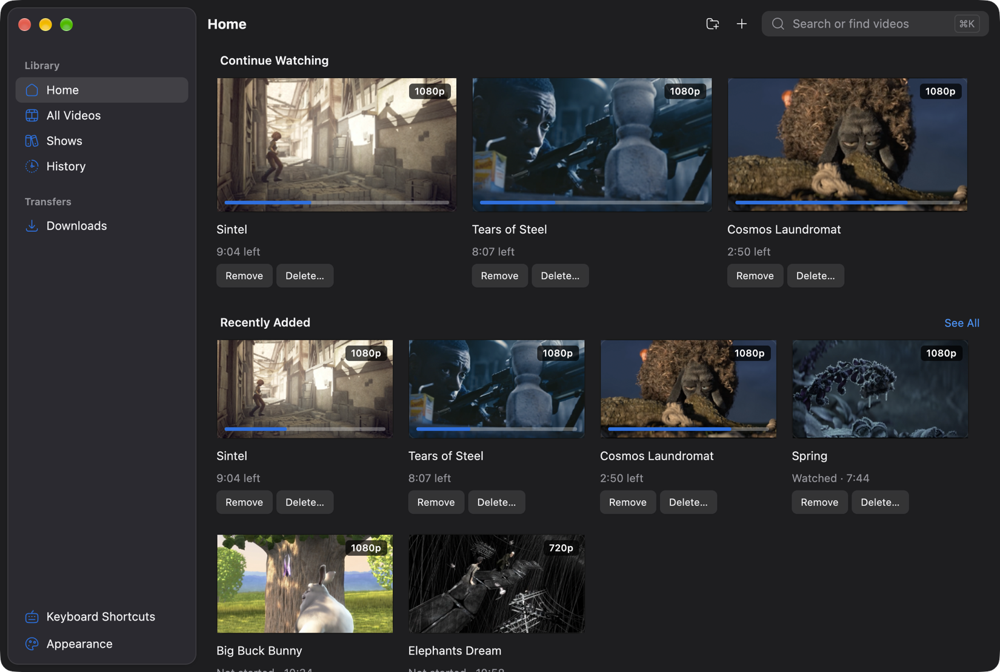
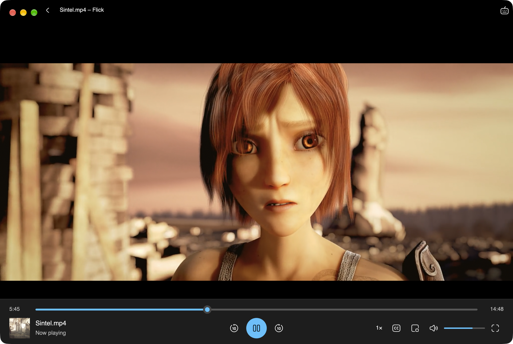
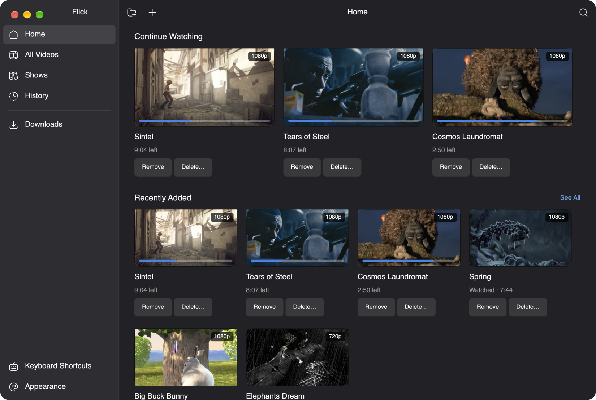

<p align="center">
  <picture>
    <source media="(prefers-color-scheme: dark)" srcset="docs/brand/flick-horizontal-reversed.svg">
    
  </picture>
</p>

<p align="center">
  A desktop video player that keeps your library in order, plays torrents while they download, and saves videos from links.
</p>

<p align="center">
  <a href="https://github.com/MohtashamMurshid/flick/actions/workflows/ci.yml"></a>
  <a href="LICENSE"></a>
  
  
</p>

<p align="center">
  
</p>

Flick is built in Rust with [GPUI](https://crates.io/crates/gpui) for the interface and [libmpv](https://mpv.io) for playback. It looks at home on macOS, Windows 11, and GNOME, and plays nearly anything mpv can.

> [!NOTE]
> Flick is an early release. There are no prebuilt downloads yet; build it from source with the steps below. [Validation](docs/VALIDATION.md) records exactly what has been tested on each platform.

## Features

- **A library that remembers.** Continue Watching, All Videos, History, and Downloads. Shows groups episodes named like `Show S01E02` and starts the next one after a short countdown.
- **Watch Now.** Start a torrent and watch it while it downloads. Flick plays only verified pieces and fetches the ones near the playhead first.
- **Torrents built in.** Pick the files you want, pause and resume, set bandwidth limits, export `.torrent` files, and share a file or folder as a magnet link.
- **Downloads from links.** Paste a YouTube, X, or other video page and Flick saves it with [yt-dlp](https://github.com/yt-dlp/yt-dlp). Direct HTTPS video links and Internet Archive items download without it, and Archive files are checked against their published SHA-1.
- **A full player.** Hardware decoding, subtitle files and OpenSubtitles search, audio and subtitle tracks with audio delay, playback speed, frame stepping, chapters, an A–B loop, picture in picture, and resume positions.
- **Command center.** Press ⌘K or Ctrl+K to find a video, search online, paste a link, or run any command.
- **Native look on every platform.** macOS, Windows 11, and GNOME styles, each with its own chrome and player controls. Light and dark schemes, accent colors, and WCAG AA contrast in every combination.
- **Keyboard first.** Tab and the arrow keys move through the library and controls, and player shortcuts can be rebound.

<table>
  <tr>
    <td></td>
    <td></td>
  </tr>
  <tr>
    <td align="center">Windows 11 style</td>
    <td align="center">GNOME style</td>
  </tr>
</table>

<sub>Screenshots taken on macOS, which is why every style shows macOS window buttons. Films are Blender open movies © Blender Foundation, <a href="https://www.blender.org">blender.org</a>: Big Buck Bunny, Sintel, and Tears of Steel (<a href="https://creativecommons.org/licenses/by/3.0/">CC BY 3.0</a>), Elephants Dream (<a href="https://creativecommons.org/licenses/by/2.5/">CC BY 2.5</a>), and Cosmos Laundromat and Spring (<a href="https://creativecommons.org/licenses/by/4.0/">CC BY 4.0</a>).</sub>

## Getting started

1. Install [Rust through rustup](https://rust-lang.org/tools/install/). It picks up the repository's pinned toolchain (1.99.0) automatically.
2. Install your platform's desktop build prerequisites, listed in [Validation](docs/VALIDATION.md#native-build-prerequisites).
3. Install libmpv:
   - **Ubuntu 24.04:** `sudo apt-get install libmpv2`
   - **macOS:** `brew install mpv`. Building also needs full Xcode for GPUI's Metal shaders.
   - **Windows:** an mpv shared-library build that matches your architecture. Put its DLL and dependencies beside `flick.exe`, or set `FLICK_MPV_LIBRARY` to the DLL's full path.
4. Clone and run:

   ```sh
   git clone https://github.com/MohtashamMurshid/flick.git
   cd flick
   cargo run --locked
   ```

   To open a file directly: `cargo run --locked -- "/path/to/video.mp4"`.

If `cargo` isn't found right after installing Rust, open a new terminal or run `. "$HOME/.cargo/env"` first.

Optional extras:

- **[yt-dlp](https://github.com/yt-dlp/yt-dlp#installation)** to download from video pages. Keep it up to date; distribution packages are often too old.
- **FFmpeg** so yt-dlp can merge the best video and audio streams.
- **A free [OpenSubtitles](https://www.opensubtitles.com) API key** to search for subtitles, entered in Appearance.

The [user guide](docs/USER_GUIDE.md) covers every screen, the full keyboard shortcut list, and the environment variables Flick reads.

## Keyboard shortcuts

<details>
<summary>Player and library shortcuts</summary>

| Key | Action |
| --- | --- |
| Space | Play or pause |
| Left / Right | Seek backward or forward 10 seconds |
| Up / Down | Raise or lower volume |
| M | Mute or unmute |
| F | Toggle fullscreen |
| P | Picture in picture |
| , / . | Previous or next frame |
| J / K / L | Slower or back 10 seconds / pause at normal speed / play, then faster |
| 0–9 | Jump to 0–90% of the video |
| Page Up / Page Down | Previous or next chapter |
| B | Set the A–B loop start, then its end, then clear it |
| [ / ] | Move audio 50 ms earlier or later |
| Shift+N / Shift+P | Next or previous episode |
| Ctrl+K / Cmd+K | Open the command center |
| Ctrl+O / Cmd+O | Add videos in the library or open a video in the player |
| Ctrl+, / Cmd+, | Open Appearance |
| ? | Show all shortcuts |

Player keys can be changed on the Keyboard Shortcuts page. The [user guide](docs/USER_GUIDE.md#keyboard-and-mouse) has the complete list.

</details>

## Platform status

CI builds, lints, and tests Flick on Linux, Windows, and macOS for every push. On macOS it also packages an ad-hoc signed app and DMG and plays a test video with the bundled libmpv. Release downloads and Windows and Linux installers are still to come. [Validation](docs/VALIDATION.md) separates passing tests, desktop builds, and real interactive playback for each platform.

To build a standalone macOS app that carries its own libmpv:

```sh
brew install mpv
scripts/package-macos.sh            # ad-hoc signed, in target/macos/
scripts/package-macos.sh --dry-run  # print the plan; works on any OS
```

See [Packaging for macOS](docs/PACKAGING.md) for signing, notarization, and licensing.

## Documentation

| Document | What's in it |
| --- | --- |
| [User guide](docs/USER_GUIDE.md) | Every screen, shortcut, and setting |
| [Transfers](docs/TRANSFERS.md) | How torrent transfers work, and the command-line transfer diagnostic |
| [Packaging for macOS](docs/PACKAGING.md) | Building, signing, and notarizing `Flick.app`, and what it bundles |
| [Plan](docs/PLAN.md) | What's built and what's next |
| [Playback and sharing design](docs/SHARING_PLAN.md) | Design and acceptance criteria for playback and sharing |
| [Headless proposal](docs/HEADLESS_PLAN.md) | A deferred proposal for a headless agent interface |
| [Validation](docs/VALIDATION.md) | Every check that has been run, by date and platform |

## Contributing

Issues and pull requests are welcome. [CONTRIBUTING.md](CONTRIBUTING.md) explains how to run the checks, the rules for transfer and download tests, and how the code is laid out.

## Responsible use

Like any BitTorrent client, Flick uploads pieces to other peers while a torrent downloads, and peers can see your IP address. Once a download completes, it keeps sharing only if you allowed that on first run; change it in Appearance → Transfers. Download and share only content you have the right to.

## License

Flick is released under the [MIT License](LICENSE). Third-party code and assets are listed in [THIRD_PARTY_NOTICES.md](THIRD_PARTY_NOTICES.md) and [assets/README.md](assets/README.md).

The packaged macOS app bundles Homebrew's libmpv and FFmpeg, which are GPL-licensed. Distributing that app means meeting the GPL's terms; [Packaging for macOS](docs/PACKAGING.md#licenses-and-what-the-bundle-ships) explains what's resolved and what isn't.
